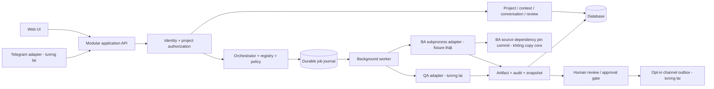
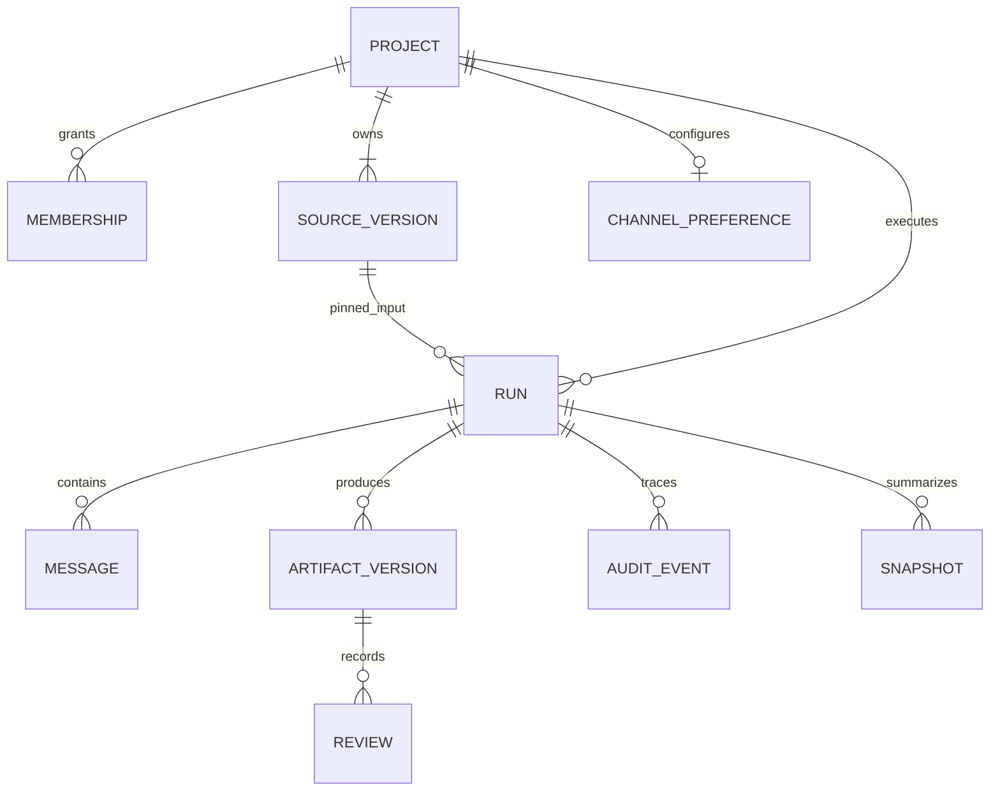

# Kiến trúc đề xuất và phần đang chạy

## Stack

React 19 + TypeScript + Vite phù hợp UI tương tác và tái sử dụng component. FastAPI + Pydantic phù hợp agent Python và typed API. SQLite đủ cho prototype một process, chạy không cần Docker/Redis/account. PostgreSQL sẽ thay SQLite khi cần nhiều user/concurrent worker; artifact lớn chuyển object storage. Polling đủ cho lần này; SSE có thể thêm sau. Không cần event bus riêng ở giai đoạn đầu.

## Kiến trúc mục tiêu ban đầu



Hiện tại Web → FastAPI → SQLite, background worker và BA supplied-proposal fixture adapter đã chạy thật. `backend/contracts.py` chứa registry cố định và input/output Pydantic. `backend/worker.py` là state machine cùng simulator. `backend/store.py` chứa persistence; `backend/app.py` là HTTP/channel preference boundary. Worker là asyncio task trong lifespan, gọi tick trong thread và thực thi BA ngoài SQLite transaction. Chưa có auth provider, connector hay channel outbox. QA/snapshot vẫn là fixture steps; workflow `ba-harness-fixture` gọi BA CLI thật. Xem `BA-INTEGRATION.md` cho module/runtime boundaries.

Giữ một deployment modular monolith + một worker process khi triển khai slice sau; không phải microservices. Subprocess adapter lấy core từ Git archive pin commit trong dependency cache, không thêm checkout Git vào workspace. Trước live model phải enforce isolation filesystem/network/process; cờ `--isolated-runtime` của BA chỉ là lời xác nhận của operator.

## Mô hình dữ liệu hiện tại



| Entity | Khóa / nội dung đáng chú ý |
|---|---|
| project | ID, name, objective, owner, created_at |
| membership | composite project_id/user_id, role; hiện fixed demo actor |
| source | ID, project_id, text, version, SHA-256; append-only qua API |
| run | ID, workflow key, state, step, version counter, turns, attempts, due, source_id |
| message | ID, run_id, role, text, timestamp; conversation suy ra từ run |
| artifact | ID, project/run, version, content JSON, hash, technical/business/approval riêng |
| review | ID, artifact_id, decision, comment, actor, timestamp; append-only |
| event | project/run, kind, detail, actor, timestamp; append-only qua API |
| snapshot | project/run, text, timestamp; internal read model |
| channel | project, enabled preference, schedule, updated_at; không lưu credential |
| ba_invocations | immutable fixture context/proposal snapshot, input hash, agent commit, BA state/result |
| ba_packs | nguyên văn bundle/review-pack/audit/manifest đã xác minh, liên kết artifact/run_hash |

DB có foreign keys và transactional writes. Access vào project/run/artifact/snapshot đi qua membership gate chung. Audit ghi text do người dùng nhập được giữ như dữ liệu và React escape khi hiển thị. Hash không phải chữ ký và audit SQLite không chống sửa bởi người có quyền ghi file.

Mở rộng sau: users + verified memberships, workflow_version, agent_version/commit, run_step/attempt ledger, explicit question và answer source versions, artifact URI/object store, approval(signature authority/version/hash), channel_identity, delivery outbox/deduplication, retention metadata. Hiện chưa lưu nguyên workflow definition theo version nên không thay registry giữa các run đang chạy.

## Luồng Requirements Discovery mô phỏng đang chạy

```mermaid
sequenceDiagram
    actor PM
    participant UI as Web
    participant API
    participant DB as SQLite
    participant WK as Worker simulator
    PM->>UI: Tạo project + notes
    UI->>API: POST projects
    API->>DB: project + membership + source v1/hash
    PM->>UI: Chạy Requirements Discovery
    UI->>API: POST project/runs
    API->>DB: queued + pinned source_id
    WK->>DB: intake → clarify → awaiting_input
    WK->>DB: question + blocker snapshot nội bộ
    UI->>API: Poll project
    API-->>UI: câu hỏi + trạng thái
    PM->>UI: Trả lời
    UI->>API: POST run/answers
    API->>DB: user message + queued draft
    WK->>DB: artifact v1/hash + schema check
    WK->>DB: handoff events + snapshot → awaiting_review
    PM->>UI: Review hoặc yêu cầu sửa
    UI->>API: POST artifact/reviews
    alt Yêu cầu sửa
        API->>DB: review v1 + queued draft v2
        WK->>DB: artifact v2 mới; v1 không đổi
    else Ghi nhận đã review
        API->>DB: business=reviewed; approval=not_approved
        API->>DB: snapshot mới
    end
    PM->>UI: Xem Telegram preview
    UI->>API: GET cùng project/snapshots
    API-->>UI: snapshot local + link đúng run
```

Luồng BA harness fixture thật được mô tả riêng tại [BA-INTEGRATION.md](BA-INTEGRATION.md).

## State machine và policy

`queued/intake → running/clarify → awaiting_input → queued/draft → running/quality → awaiting_review → reviewed`. `needs_changes` quay về `queued/draft` với version tăng. Timeout hoặc retry exhaustion thành `failed`; không tự xuất accepted artifact khi tạo draft lỗi.

- Một run xử lý/chờ input tại một thời điểm cho mỗi project; duplicate answer bị 409.
- Tối đa 3 artifact versions, 6 lượt, một retry mỗi step. Handoff chỉ là các bước cố định cùng project; agent không tự gọi agent tùy ý.
- Với simulator, deadline mỗi scheduled step 20s, persisted `due`. Với BA fixture, CLI timeout 15s, verify timeout 10s, worker lease 35s và một retry runtime; không retry domain rejection. Restart trước deadline tiếp tục; outage quá deadline kết thúc failed. Chưa có UI resume/cancel run failed; tạo run mới sau khi xem event.
- Mỗi transition trong transaction/worker savepoint; lỗi retry rollback partial output. SQLite `BEGIN IMMEDIATE` serialize worker và HTTP writes.
- Review chỉ chấp nhận version mới nhất đã xong quality step; content/hash cũ không đổi. Business metadata có thể thay đổi theo review events.
- Human chờ làm rõ/review không bị timeout 20s. Model cost luôn $0 vì không có model provider. Đây chưa phải bộ đo/chặn budget token cho live model.
- Technical=`schema_passed`, business=`pending/reviewed/needs_changes`, approval=`not_approved` độc lập. Không có nhánh auto-approve.

## Web / Telegram dùng chung quyền

Thiết kế tương lai: webhook xác minh secret + dedupe update_id → channel identity đã liên kết qua web authenticated session → project authorization → cùng application service cho status/latest. Project ID hoặc Telegram chat ID tự nó không cấp quyền. Khi quyền bị thu hồi phải từ chối cả đọc snapshot và gửi mới, kiểm tra lại trước delivery. Group chat mặc định không nhận nội dung nhạy cảm. Approval và mutation chi tiết quay về web; không cho bot/model tự cấp quyền hoặc chấp thuận.

Hiện chỉ có web demo membership gate; preview dùng cùng API response, không phải xác thực Telegram thật. Chưa có scheduling/delivery hoặc webhook. UI lưu preference để review sản phẩm.

## Giới hạn có chủ đích

Không real auth/multi-tenant hardening, migrations, backup/restore tooling, file parsing, content redaction, full body/rate limits, live costs, complete observability, distributed locks hoặc long-run management. Không dùng prototype cho dữ liệu thật hoặc public access. Chưa xác nhận business UAT/product acceptance; các test kỹ thuật chỉ là bằng chứng hành vi phần mềm ở phạm vi này.
