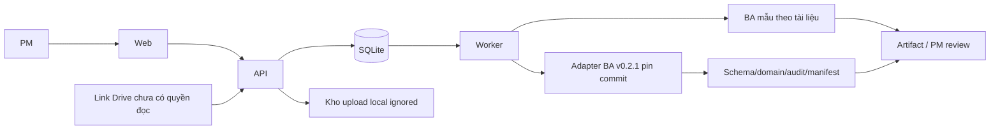

# MVP tài liệu → BA → PM review

Web React gọi FastAPI; SQLite giữ trạng thái; một worker nền cùng ứng dụng xử lý job. Không tách microservice. Drive adapter chỉ lưu link và trạng thái chưa kết nối, không thực hiện HTTP tới link người dùng. Backend giữ cấu hình/secret; chưa bật model, OAuth hoặc Telegram thật.

Mô hình bổ sung: Project → Document → DocumentVersion → Source (text trích xuất bất biến). Run là job có state/lease/retry; JobInput gắn run với danh sách DocumentVersion và snapshot text/hash. BA invocation lưu canonical context/proposal/commit; Artifact và AuditEvent gắn cùng project/run. Registry agent có contract/version, snapshot phiên bản trong invocation. Không duy trì hai bản state job/run cạnh tranh.

Luồng chính: tạo project → upload TXT/MD/PDF/DOCX hoặc lưu link Drive → chọn phiên bản đọc được → bấm Chạy BA → job queued/running → hỏi làm rõ → trả lời → draft → PM review/download. Luồng mẫu được ghi nhãn rõ và không gọi model. BA thật dùng context chuẩn bị + supplied proposal, không tự lấy proposal công nợ cho tài liệu khác. Quyền chạy thử chỉ dành dữ liệu giả lập; người khai báo chưa xác thực, review không cấp baseline/UAT approval.

Upload: tối đa 5 MiB/file, whitelist extension/MIME và kiểm cấu trúc, filename an toàn, storage ID do server sinh, không lưu trong Git. Trích xuất giới hạn 100 KB UTF-8/100 trang PDF, DOCX có giới hạn ZIP; parser subprocess timeout và không theo link/embedded object. PDF scan không có text được lưu ở needs_text, cần bản có text/TXT; không giả vờ đọc thành công. Phiên bản mới không làm thay đổi job cũ.

Drive: chỉ chấp nhận link file Google hợp lệ và lưu URL chuẩn hóa; status requires_connection, không bắt file công khai. Adapter sau này dùng OAuth backend và token store ngoài Git. Link chưa đọc được không dùng làm input của job.
